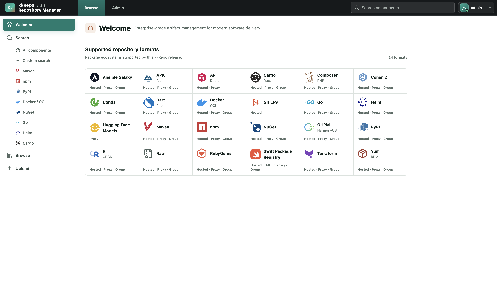
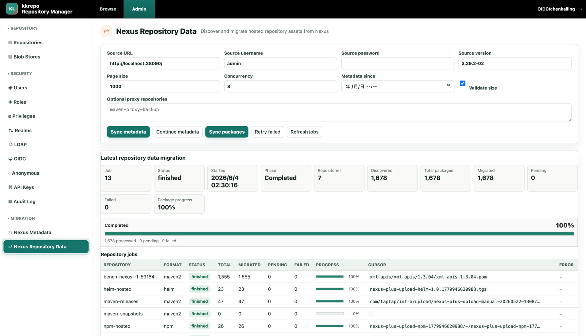
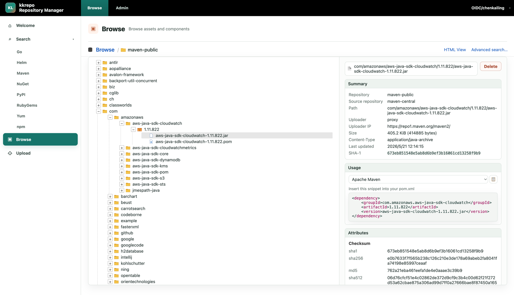
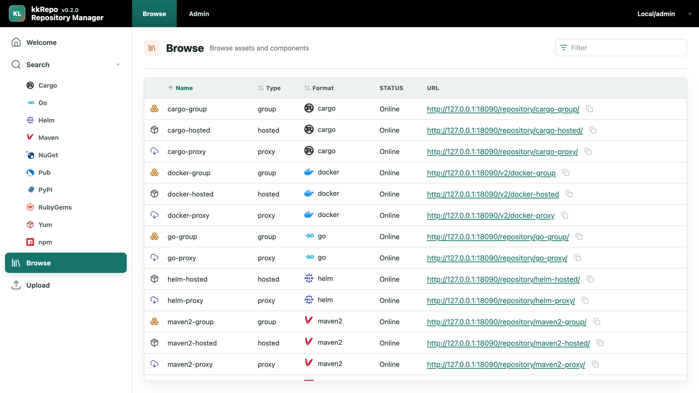
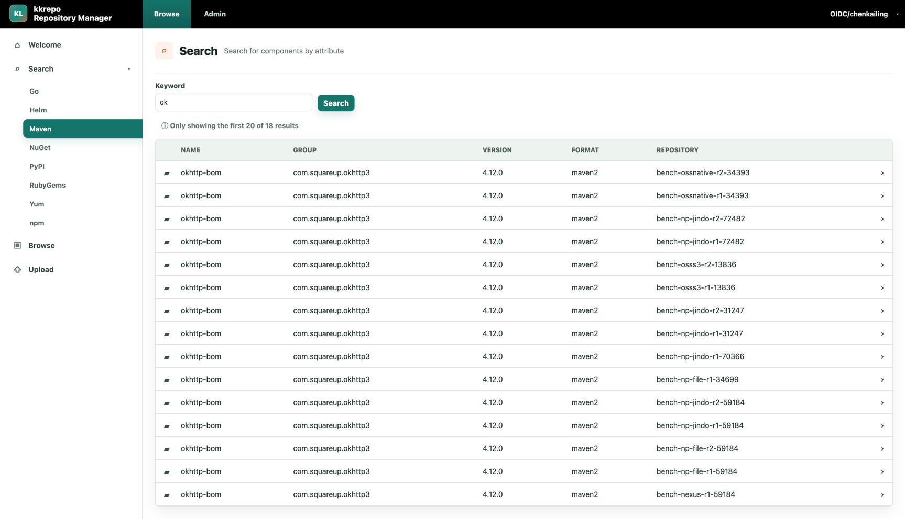
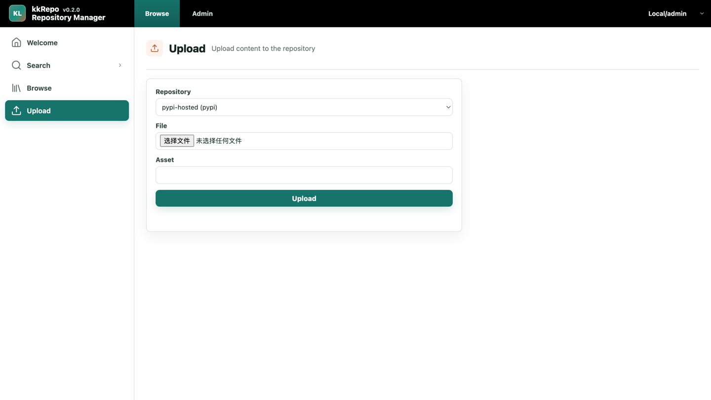
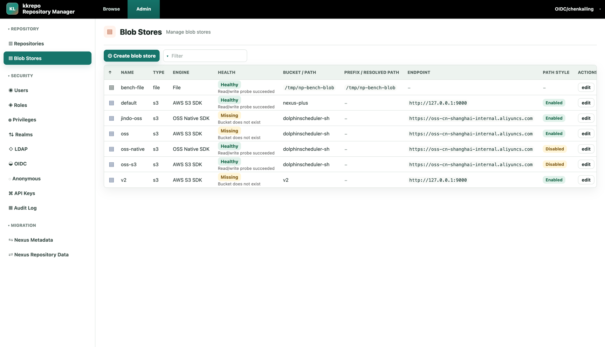
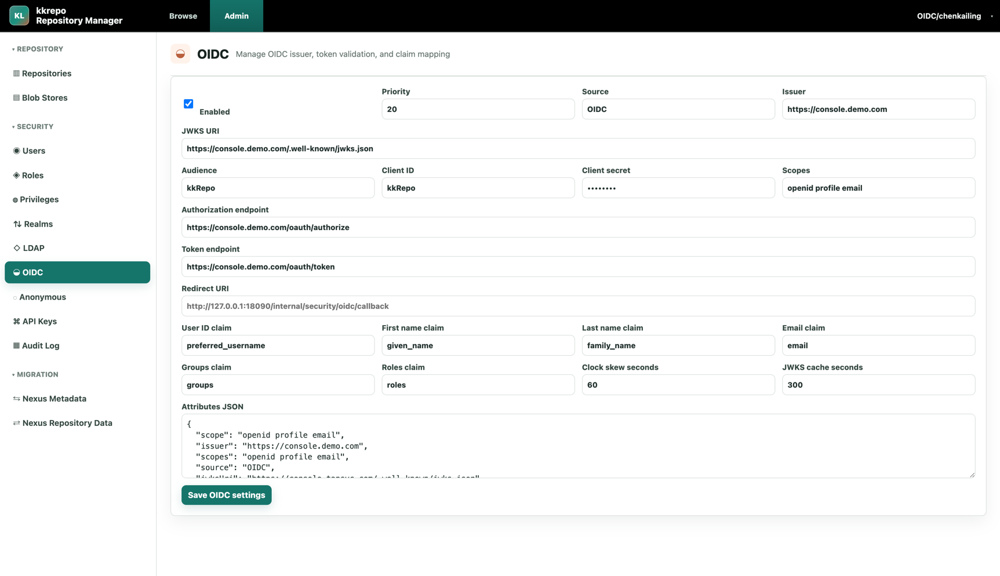
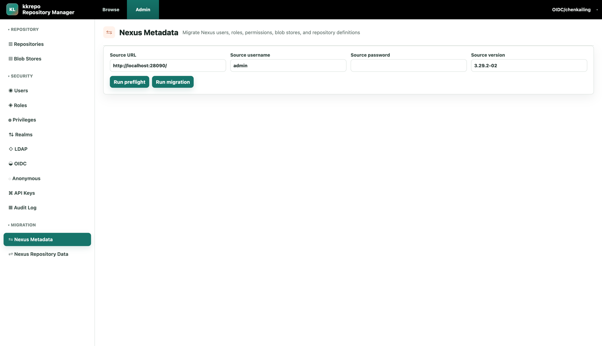

# kkRepo

[](https://github.com/klboke/kkrepo/actions/workflows/ci.yml)
[](https://codecov.io/gh/klboke/kkRepo)
[](https://github.com/klboke/kkrepo/releases)
[](LICENSE)
[](https://github.com/klboke/kkrepo/pkgs/container/kkrepo)
[](SECURITY.md)

[English](README.md) | **中文**

kkRepo 是一个由社区驱动的开源、自托管制品仓库，旨在解决 Sonatype Nexus 社区版的各类限制与痛点，为社区提供开放、可靠且可持续演进的制品管理方案。

你可以用它发布私有包、缓存上游依赖，也可以把已有的 Sonatype Nexus Repository 仓库迁入 kkRepo。支持 Maven、npm、Docker/OCI 等 24 种格式。

[为什么开发 kkRepo](docs/zh/why-kkrepo.md) · [快速开始](#快速开始) · [支持的仓库](#支持的仓库) · [核心特性](#核心特性) · [从 Nexus 迁移](#从-sonatype-nexus-repository-迁移) · [生产部署](docs/zh/build-deployment-guide.md)



## 快速开始

本地需要 Docker、Docker Compose 和 curl。在一个空目录中运行以下命令，启动 JVM 版 kkRepo 和 MySQL：

```bash
curl -fsSL https://raw.githubusercontent.com/klboke/kkrepo/main/scripts/quickstart.sh | bash
```

### 上传第一个制品

1. 打开[管理控制台](http://127.0.0.1:19090/admin/)，按提示为本地管理员 `admin` 设置密码。
2. 在 **Blob Stores** 中创建名为 `default` 的 File 存储，供本地试用。
3. 在 **Repositories** 中选择 `raw-hosted`，将仓库命名为 `raw-demo`，选择刚创建的存储并保存。

下面的命令会提示输入管理员密码。先上传一行文本，再从相同地址读回：

```bash
url=http://127.0.0.1:19090/repository/raw-demo/hello.txt
printf 'Hello, kkRepo!\n' > hello.txt
curl --fail --user admin --upload-file hello.txt "$url"
curl --fail --user admin "$url"
```

看到 `Hello, kkRepo!` 就完成了第一次制品发布和下载。也可以在[用户侧浏览器](http://127.0.0.1:19090/browse/)中打开 `raw-demo`，查看 `hello.txt` 的大小、校验和及下载地址。

<details>
<summary>PostgreSQL、Native 镜像和健康检查</summary>

默认组合是 JVM 和 MySQL。使用 PostgreSQL 时，在启动命令中将 `| bash` 改为 `| KKREPO_DATABASE_TYPE=postgresql bash`；使用 Native 镜像时改为 `| KKREPO_RUNTIME=native bash`。两个变量可以组合使用。

[本地健康检查](http://127.0.0.1:19091/actuator/health) · [查看启动脚本](scripts/quickstart.sh) · [构建与部署指南](docs/zh/build-deployment-guide.md)

</details>

## 支持的仓库

| 格式 | Hosted | Proxy | Group | [Nexus 迁移](docs/zh/nexus-migration-guide.md) |
| :--- | :---: | :---: | :---: | :---: |
| [Maven](docs/zh/repository-guides/maven.md) | ✓ | ✓ | ✓ | ✓ |
| [npm](docs/zh/repository-guides/npm.md) | ✓ | ✓ | ✓ | ✓ |
| [OHPM / HarmonyOS](docs/zh/repository-guides/ohpm.md) | ✓ | ✓ | ✓ | ✗ |
| [PyPI](docs/zh/repository-guides/pypi.md) | ✓ | ✓ | ✓ | ✓ |
| [Go](docs/zh/repository-guides/go.md) | ✓ | ✓ | ✓ | ✓ |
| [Helm](docs/zh/repository-guides/helm.md) | ✓ | ✓ | ✓ | ✓ |
| [Cargo / Rust](docs/zh/repository-guides/cargo-rust.md) | ✓ | ✓ | ✓ | ✓ |
| [Dart / Pub](docs/zh/repository-guides/dart-pub.md) | ✓ | ✓ | ✓ | ✓ |
| [Composer / PHP](docs/zh/repository-guides/composer-php.md) | ✓ | ✓ | ✓ | ✓ |
| [Terraform Provider / Module Registry](docs/zh/repository-guides/terraform.md) | ✓ | ✓ | ✓ | ✓ |
| [Swift Package Registry](docs/zh/repository-guides/swift-package-registry.md) | ✓ | ✓ | ✓ | ✓ |
| [Ansible Galaxy](docs/zh/repository-guides/ansible-galaxy.md) | ✓ | ✓ | ✓ | ✓ |
| [Conda](docs/zh/repository-guides/conda.md) | ✓ | ✓ | ✓ | ✓ |
| [APT / Debian](docs/zh/repository-guides/apt-debian.md) | ✓ | ✓ | ✗ | ✓ |
| [Conan 2](docs/zh/repository-guides/conan-2.md) | ✓ | ✓ | ✓ | ✓ |
| [Alpine / APK](docs/zh/repository-guides/alpine-apk.md) | ✓ | ✓ | ✓ | ✓ |
| [R / CRAN](docs/zh/repository-guides/r-cran.md) | ✓ | ✓ | ✓ | ✓ |
| [Hugging Face Models](docs/zh/repository-guides/hugging-face-models.md) | ✗ | ✓ | ✗ | ✓ |
| [Docker / OCI](docs/zh/repository-guides/docker-oci.md) | ✓ | ✓ | ✓ | ✓ |
| [NuGet](docs/zh/repository-guides/nuget.md) | ✓ | ✓ | ✓ | ✓ |
| [RubyGems](docs/zh/repository-guides/rubygems.md) | ✓ | ✓ | ✓ | ✓ |
| [Yum](docs/zh/repository-guides/yum.md) | ✓ | ✓ | ✓ | ✓ |
| [Git LFS](docs/zh/repository-guides/git-lfs.md) | ✓ | ✗ | ✗ | ✓ |
| [Raw](docs/zh/repository-guides/raw.md) | ✓ | ✓ | ✓ | ✓ |

Nexus 迁移列的 ✓ 表示该格式有受支持的迁移路径。适用的仓库类型、数据范围和 Nexus 版本见迁移指南。

## 核心特性

- **制品分发。** Hosted 保存团队发布的制品；Proxy 按需缓存上游依赖；Group 为多个仓库提供统一的读取地址。各格式支持的组合见上表。
- **代理流式下载。** 按仓库启用后，首次拉取未缓存的 Docker 镜像层、Maven 制品或 PyPI 包时，客户端可以在 kkRepo 从上游读取数据的同时开始下载。完整制品通过校验后才写入缓存。[支持的制品与启用条件](docs/zh/dev/proxy-streaming-downloads.md)
- **下载卸载。** 对已存入 File Blob Store 的制品，kkRepo 完成鉴权和扫描策略检查后，可将完整文件下载交给 Nginx 等受信任的反向代理。大文件由代理直接发送，减少流经应用实例的数据量。[Nginx 下载卸载配置](docs/zh/nginx-reverse-proxy.md#下载卸载)
- **身份与访问。** 支持本地账号、LDAP 和 OIDC，可通过角色分配仓库权限，为 CI 签发令牌，并配置匿名读取。[权限与认证](docs/zh/security-model.md)
- **扫描与清理。** 可为选定仓库启用 SBOM 和漏洞扫描，按策略阻止下载或配置豁免；清理策略支持在删除前预览匹配的制品。[安全扫描](docs/zh/artifact-scanning-guide.md) · [清理策略](docs/zh/cleanup-policy-guide.md)
- **多副本部署。** 副本通过 MySQL 或 PostgreSQL 共享元数据、会话和任务状态。生产环境可将制品存入 S3、阿里云 OSS 或 Azure Blob Storage。[部署架构](docs/zh/build-deployment-guide.md) · [Azure 存储](docs/zh/azure-blob-storage.md)

默认发行版使用 JVM，也提供 Native 镜像。在 2 CPU、1 GiB 容器限制的本地基准中，Native 从创建容器到就绪的中位数为 **1.04 秒**，空闲容器内存中位数为 **170.4 MiB**。测试配置和预热后的吞吐量对比见 [Native 与 JVM 选型指南](docs/zh/native-vs-jvm-guide.md)。

## 从 Sonatype Nexus Repository 迁移

kkRepo 团队迁移自己的制品仓库时保留了原域名，切换后 CI 继续使用已有的 Maven settings、npm registry 和 PyPI index URL。部署背景和切换结果见[团队迁移记录](docs/zh/why-kkrepo.md#迁移结果)。

1. **确认范围并预检。** 核对源 Nexus 版本、仓库格式和要迁移的数据，在管理控制台的 **Nexus Metadata** 页面运行预检，处理报告中的阻塞项。
2. **迁移配置和制品。** 先迁移用户、权限和仓库定义，再从 **Nexus Repository Data** 同步元数据和制品。首次执行全量同步；后续可增量同步，中断后可恢复。
3. **验证并切换。** 用现有客户端验证权限和下载，再切换原域名。普通仓库沿用 `/repository/<repo>/...`；Docker/OCI 还需保留 `/v2/` 入口、仓库名和路由方式。



[各格式迁移范围与前置条件](docs/zh/nexus-migration-guide.md) · [迁移实战手册](docs/zh/migration-playbook.md)

<details>
<summary>更多 Browse 和 Admin 界面截图</summary>















</details>

## 文档

| 分类 | 推荐阅读 |
| --- | --- |
| 项目背景与实践 | [为什么开发 kkRepo](docs/zh/why-kkrepo.md) · [用户案例：一家光伏制造企业从 Nexus 迁移的经历](docs/zh/blog/nexus-to-kkrepo-migration-case.md) |
| 架构与选型 | [架构设计](docs/zh/architecture.md) · [数据库后端](docs/zh/database-backends.md) · [数据库表结构](docs/zh/database-schema.md) · [MySQL 实体关系图](docs/zh/mysql-er.md) |
| 兼容性与验证 | [格式兼容性矩阵](docs/zh/compatibility-matrix.md) · [如何对照 Nexus 做测试](docs/zh/nexus-compatibility-testing.md) · [Nexus REST API 对照分析（英文）](docs/en/dev/nexus-rest-api-alignment.md) |
| 性能实测 | [Native 与 JVM 对比](docs/zh/native-vs-jvm-guide.md) · [代理流式下载](docs/zh/dev/proxy-streaming-performance.md) · [APT 与 Nexus 对比](docs/zh/dev/apt-performance-baseline.md) |
| 仓库与客户端 | [各格式使用指南](docs/zh/repository-guides/README.md) · [客户端配置示例](docs/zh/client-recipes.md) · [搭建 Maven 私服](docs/zh/blog/setup-maven-private-repository-with-kkrepo.md) |
| 从 Nexus 迁移 | [支持范围与前置条件](docs/zh/nexus-migration-guide.md) · [迁移实战手册](docs/zh/migration-playbook.md) |
| 部署与运维 | [构建与部署](docs/zh/build-deployment-guide.md) · [生产加固](docs/zh/production-hardening.md) · [Nginx 反向代理](docs/zh/nginx-reverse-proxy.md) · [监控](docs/zh/monitoring-observability-guide.md) · [备份与恢复](docs/zh/backup-restore.md) |
| 权限与制品治理 | [安全模型](docs/zh/security-model.md) · [内容选择器](docs/zh/content-selectors.md) · [制品扫描](docs/zh/artifact-scanning-guide.md) · [清理策略](docs/zh/cleanup-policy-guide.md) · [存储用量](docs/zh/admin-storage-usage.md) |
| 排障与开发 | [常见问题](docs/zh/faq.md) · [故障排查](docs/zh/troubleshooting.md) · [开发指南](docs/zh/development-guide.md) |

## 路线图

### 计划中

- **Eclipse p2** — 代理 Eclipse 和 Equinox 的更新站点。
- **CocoaPods** — 通过 Nexus 兼容的代理仓库获取 CocoaPods 依赖。

### 已交付

| 平台能力 | 已交付内容 | 相关文档 |
| --- | --- | --- |
| PostgreSQL 后端 | 支持 MySQL 和 PostgreSQL，分别验证数据库升级与多副本运行。 | [数据库后端指南](docs/zh/database-backends.md) · [设计方案](docs/zh/dev/pluggable-database-access-layer-design.md) |
| 制品安全扫描 | 按仓库启用异步 SBOM 和漏洞分析，可按策略阻止下载。 | [使用指南](docs/zh/artifact-scanning-guide.md) · [设计说明](docs/zh/dev/security-scanning-design.md) |

<details>
<summary>仓库格式里程碑（17 项）</summary>

| 仓库格式 | 已交付内容 | 相关文档 |
| --- | --- | --- |
| Docker / OCI | 镜像推送、拉取和上游缓存。 | [实现说明](docs/zh/dev/docker-repository-implementation-plan.md) |
| Cargo / Rust | 支持 crate 发布、搜索和 Nexus 仓库迁移。 | [设计说明](docs/zh/dev/cargo-rust-repository-design.md) |
| Dart / Pub | 支持包发布、搜索及 Nexus 迁移，并通过真实客户端验证。 | [设计说明](docs/zh/dev/dart-pub-repository-design.md) |
| Composer / PHP | 支持 Composer 2 安装，以及显式选择的 Nexus 代理缓存迁移。 | [设计说明](docs/zh/dev/composer-php-repository-design.md) |
| Terraform | 托管 Module 和 Provider，支持 Provider GPG 签名。 | [设计说明](docs/zh/dev/terraform-repository-design.md) |
| Swift Package Registry | 支持签名发布和不可变版本，通过 SwiftPM 和 Xcode 验证。 | [设计说明](docs/zh/dev/swift-package-registry-design.md) |
| Ansible Galaxy | 通过 Galaxy v3 发布 collection、解析依赖，并验证多副本导入。 | [使用指南](docs/zh/repository-guides/ansible-galaxy.md) · [设计说明](docs/zh/dev/ansible-galaxy-repository-design.md) |
| Conda | 支持两种包格式，并生成 JSON、BZ2 和 ZSTD 格式的 repodata。 | [设计说明](docs/zh/dev/conda-repository-design.md) |
| APT / Debian | 签名仓库元数据，通过真实 APT 客户端和 Nexus 对照验证。 | [使用指南](docs/zh/repository-guides/apt-debian.md) · [设计说明](docs/zh/dev/apt-debian-repository-design.md) · [性能基线](docs/zh/dev/apt-performance-baseline.md) |
| Conan 2 | 支持包修订版发布、清理和复合包扫描。 | [使用指南](docs/zh/repository-guides/conan-2.md) · [设计说明](docs/zh/dev/conan-repository-design.md) · [性能基线](docs/zh/dev/conan-performance-baseline.md) |
| Alpine / APK | 校验 APK v2 包，生成签名索引，支持代理重签。 | [使用指南](docs/zh/repository-guides/alpine-apk.md) · [设计说明](docs/zh/dev/alpine-apk-repository-design.md) · [性能基线](docs/zh/dev/alpine-performance-baseline.md) |
| Hugging Face Models | 按提交版本代理模型文件，支持 LFS 和 Xet 下载。 | [使用指南](docs/zh/repository-guides/hugging-face-models.md) · [设计说明](docs/zh/dev/hugging-face-models-repository-design.md) · [性能基线](docs/zh/dev/hugging-face-models-performance-baseline.md) |
| R / CRAN | 按包目录生成 PACKAGES.gz 索引，支持 R 客户端安装。 | [使用指南](docs/zh/repository-guides/r-cran.md) · [设计说明](docs/zh/dev/r-cran-repository-design.md) · [性能基线](docs/zh/dev/r-cran-performance-baseline.md) |
| Go | 校验并发布 Go module ZIP，通过真实 Go 客户端验证。 | [使用指南](docs/zh/repository-guides/go.md) · [性能基线](docs/zh/dev/go-hosted-performance-baseline.md) |
| OHPM / HarmonyOS | 支持流式 HAR/HSP 发布、可恢复导入及可选签名登录。 | [使用指南](docs/zh/repository-guides/ohpm.md) · [签名登录](docs/zh/dev/ohpm-login.md) · [测试覆盖与边界](docs/zh/dev/ohpm-acceptance.md) |
| Helm Group | 支持嵌套仓库组，按配置顺序合并 chart 索引。 | [使用指南](docs/zh/repository-guides/helm.md) |
| Git LFS | 支持 Batch、流式上传和对象校验，按仓库控制访问。 | [使用指南](docs/zh/repository-guides/git-lfs.md) · [实现设计](docs/zh/dev/git-lfs-repository-design.md) |

</details>

[完整版本记录](CHANGELOG.md)

## 谁在使用 kkRepo？

如果你的团队正在使用 kkRepo，欢迎在[用户登记 Issue](https://github.com/klboke/kkRepo/issues/93) 留下组织名称，简单说说你们怎么用它，例如从 Nexus 迁移，或第一次搭建私有制品仓库。你的分享能帮助正在选型的团队找到相似的使用场景，也能让维护者了解哪些团队在使用 kkRepo，以及他们的实际需求。

该 Issue 专用于使用方登记。反馈 Bug 或提出功能建议，请使用[对应的 Issue 模板](https://github.com/klboke/kkRepo/issues/new/choose)。

## 参与贡献

欢迎提交 issue 和 pull request。贡献流程、PR 要求、兼容性测试要求和多副本设计约束见 [CONTRIBUTING.md](CONTRIBUTING.md)。社区行为准则见 [CODE_OF_CONDUCT.md](CODE_OF_CONDUCT.md)。

本地开发和测试说明见 [中文开发指南](docs/zh/development-guide.md)；构建部署说明见 [构建部署指南](docs/zh/build-deployment-guide.md)；AI agent 和贡献者约束见 [AGENTS.md](AGENTS.md)。

## 支持

加入 [kkRepo Telegram 群](https://t.me/+UbIsTKXTzxBhYjFl) 获取社区支持和使用交流。Issue 分类、支持范围和安全问题报告边界见 [SUPPORT.md](SUPPORT.md)。

## 赞助者

感谢所有支持 kkRepo 持续开发和维护的赞助者。你可以通过 [GitHub Sponsors](https://github.com/sponsors/klboke) 支持本项目。

你也可以通过支付宝或微信支付赞助 kkRepo。

<p>
  <a href="docs/img/sponsors/alipay.jpg"></a>
  &nbsp;&nbsp;
  <a href="docs/img/sponsors/wechat-pay.jpg"></a>
</p>

### 企业赞助者

当前企业赞助者的 Logo 和链接将在此展示。

### 项目支持者

当前项目支持者的名称或 Logo 及可选链接将在此展示。

## 安全

如果发现安全问题，请按 [SECURITY.md](SECURITY.md) 说明优先通过 GitHub Security Advisory 报告，避免在公开 issue 中直接披露可利用细节。普通 bug、兼容性问题和功能建议可以直接提交 issue。

## 许可证

kkRepo 使用 [Apache License 2.0](LICENSE) 开源。

## 商标声明

Sonatype、Nexus 和 Nexus Repository 是 Sonatype, Inc. 的商标。kkRepo 是独立开源项目，不隶属于 Sonatype, Inc.，也未获得其认可、赞助或背书。文档中对 Sonatype Nexus Repository 的引用仅用于准确说明兼容性、迁移或互操作性。
