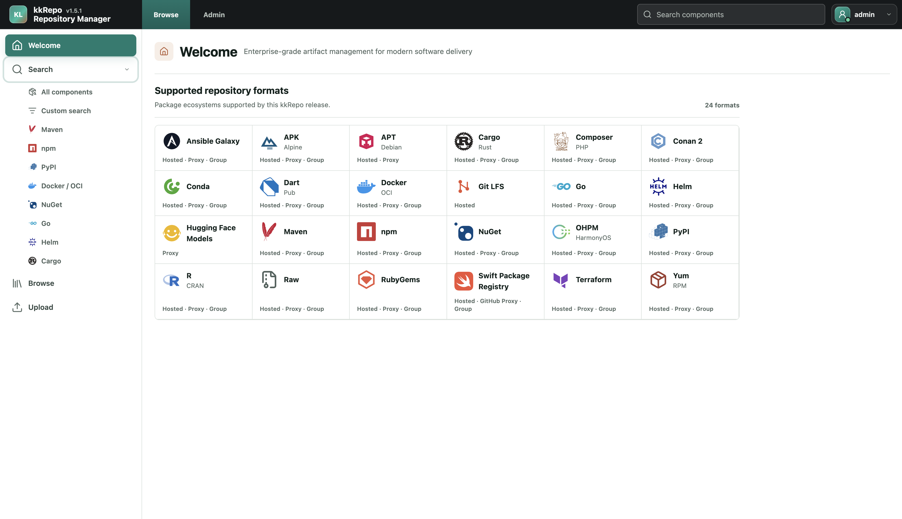
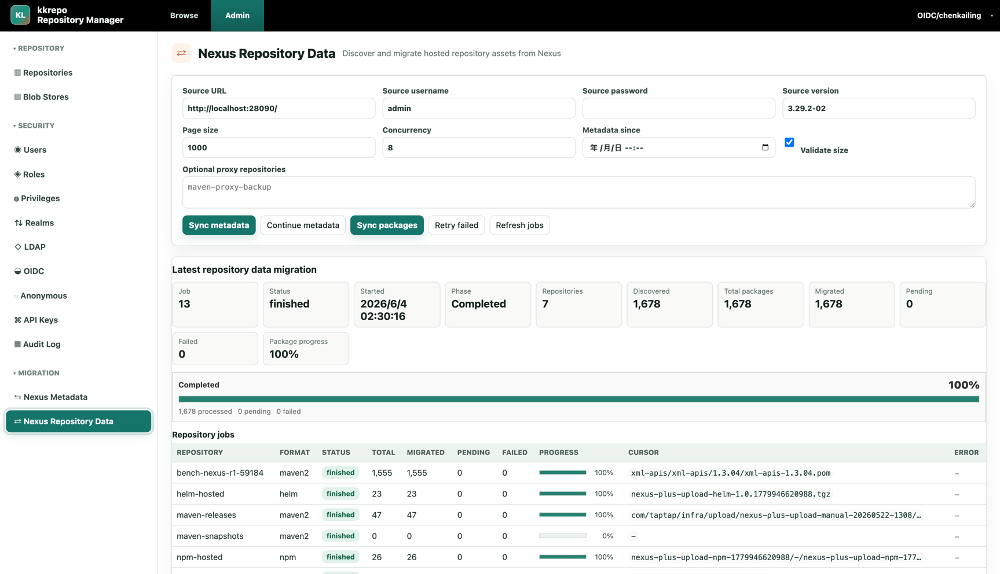
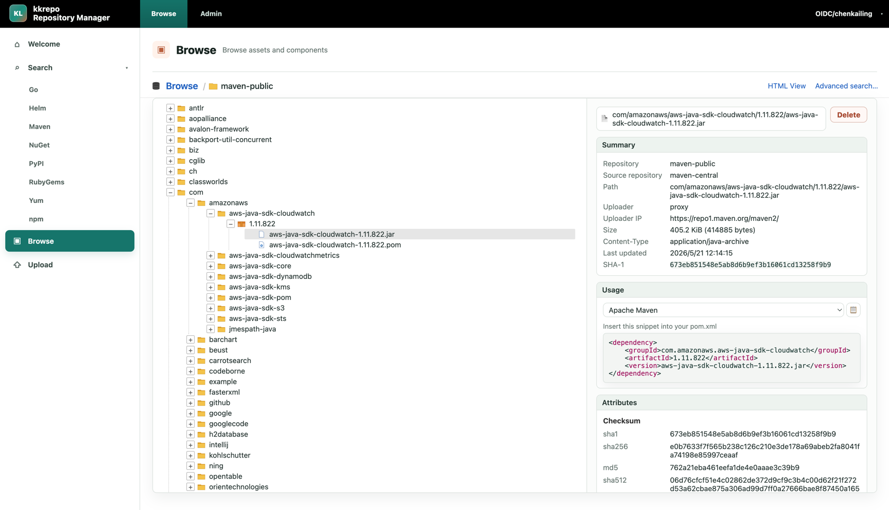
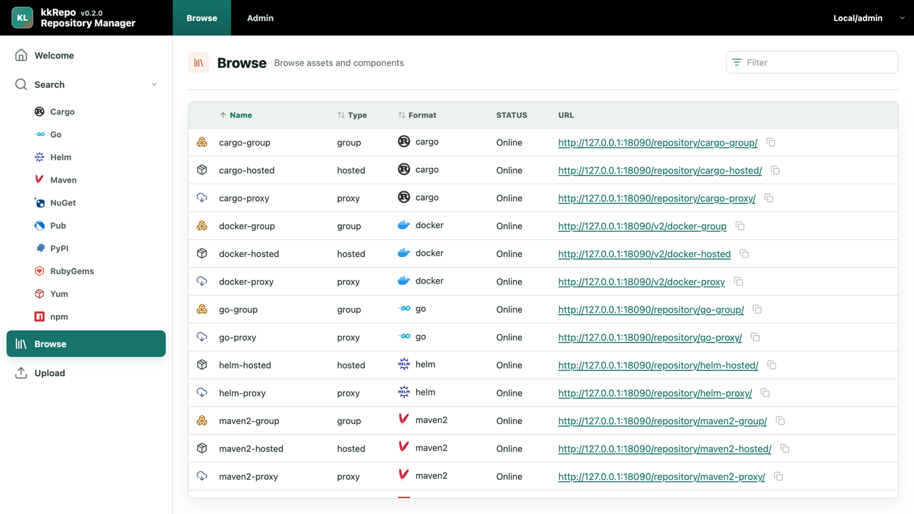
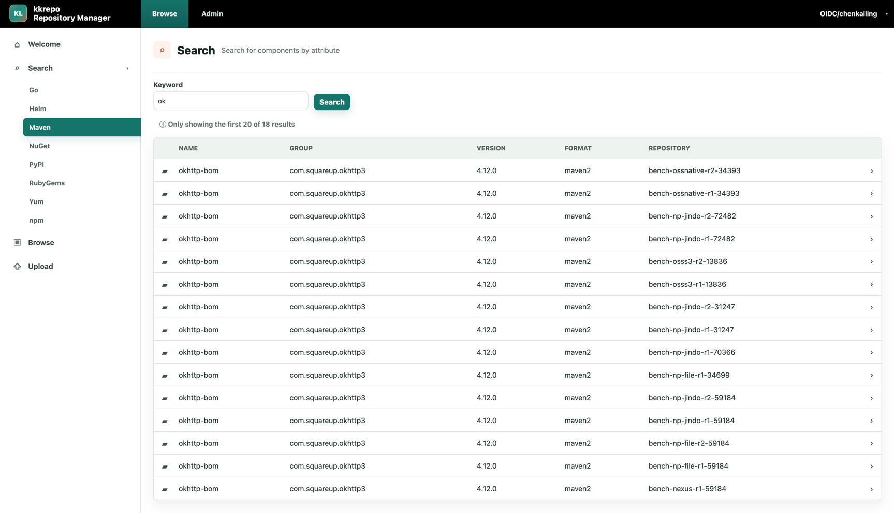
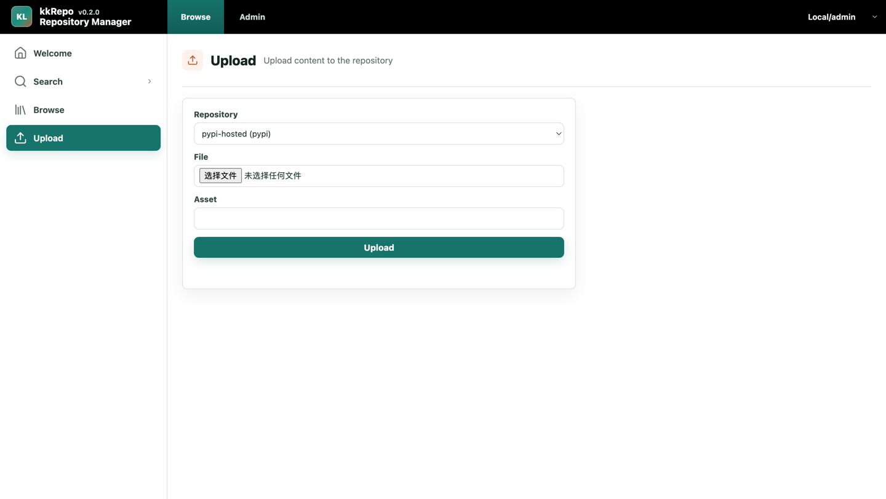
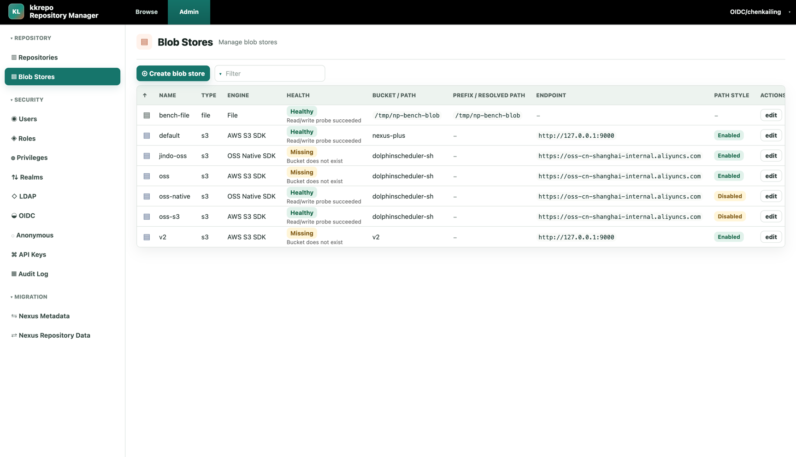
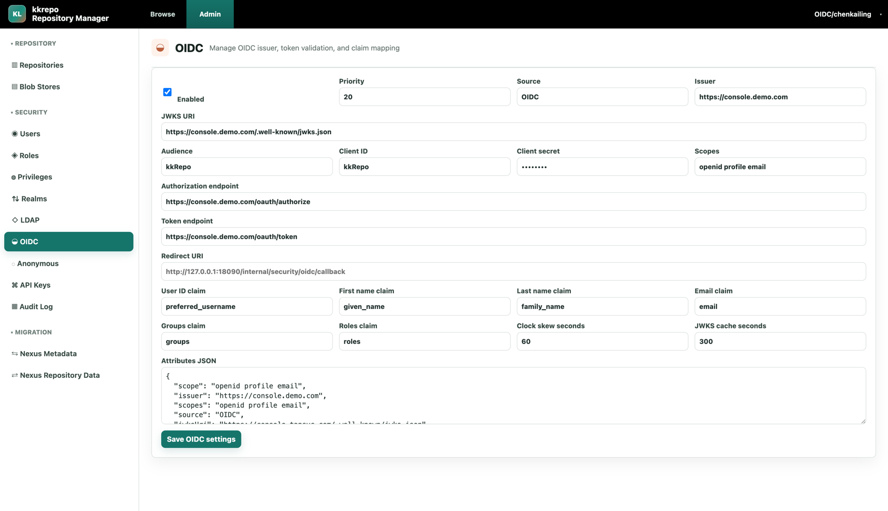
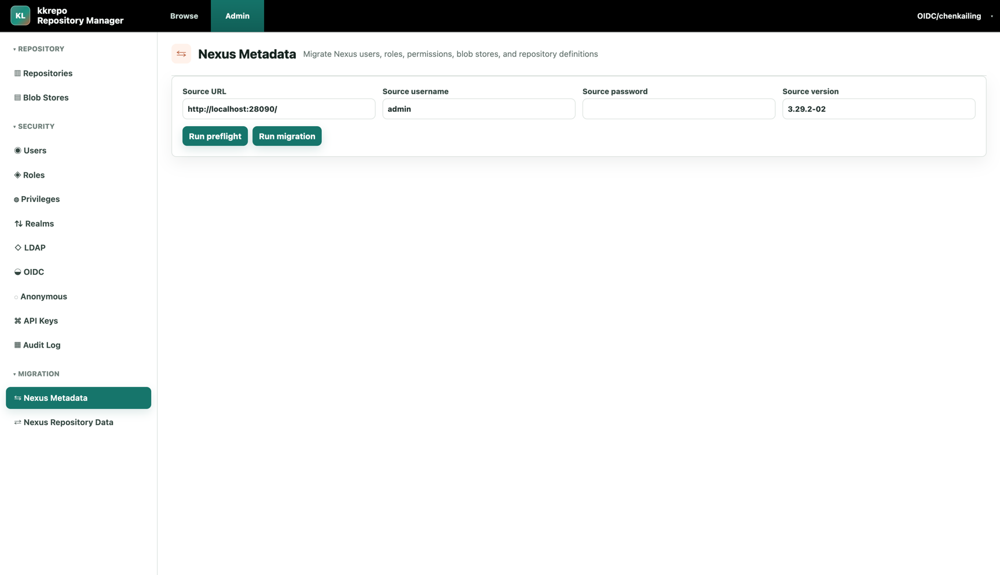

# kkRepo

[](https://github.com/klboke/kkrepo/actions/workflows/ci.yml)
[](https://codecov.io/gh/klboke/kkRepo)
[](https://github.com/klboke/kkrepo/releases)
[](LICENSE)
[](https://github.com/klboke/kkrepo/pkgs/container/kkrepo)
[](SECURITY.md)

**English** | [中文](README.cn.md)

kkRepo is a community-driven, open-source, self-hosted artifact repository. We built it to address the limitations and operational challenges of Sonatype Nexus Community Edition and give the community an open, reliable artifact manager it can maintain and improve over time.

Use it to publish private packages, cache upstream dependencies, or migrate existing Sonatype Nexus Repository installations. It supports 24 formats, including Maven, npm, and Docker/OCI.

[Why kkRepo?](docs/en/why-kkrepo.md) · [Quick start](#quick-start) · [Supported repositories](#supported-repositories) · [Core features](#core-features) · [Migrate from Nexus](#migrating-from-sonatype-nexus-repository) · [Production deployment](docs/en/build-deployment-guide.md)



## Quick Start

With Docker, Docker Compose, and curl installed, run this command in an empty directory to start kkRepo on the JVM with MySQL:

```bash
curl -fsSL https://raw.githubusercontent.com/klboke/kkrepo/main/scripts/quickstart.sh | bash
```

### Upload your first artifact

1. Open the [admin console](http://127.0.0.1:19090/admin/) and set a password for the initial local administrator, `admin`.
2. Under **Blob Stores**, create a File blob store named `default` for this local trial.
3. Under **Repositories**, choose `raw-hosted`, name the repository `raw-demo`, select the blob store you just created, and save.

Upload a line of text, then read it back from the same URL. Enter the admin password when curl prompts you.

```bash
url=http://127.0.0.1:19090/repository/raw-demo/hello.txt
printf 'Hello, kkRepo!\n' > hello.txt
curl --fail --user admin --upload-file hello.txt "$url"
curl --fail --user admin "$url"
```

When the download prints `Hello, kkRepo!`, you have published and retrieved your first artifact. Open `raw-demo` in the [repository browser](http://127.0.0.1:19090/browse/) to see the file size, checksums, and download URL for `hello.txt`.

<details>
<summary>PostgreSQL, Native images, and health checks</summary>

The default runtime and database are JVM and MySQL. For PostgreSQL, replace `| bash` in the startup command with `| KKREPO_DATABASE_TYPE=postgresql bash`. For the Native image, use `| KKREPO_RUNTIME=native bash`. You can set both variables together.

[Local health check](http://127.0.0.1:19091/actuator/health) · [Inspect the startup script](scripts/quickstart.sh) · [Build and deployment guide](docs/en/build-deployment-guide.md)

</details>

## Supported Repositories

| Format | Hosted | Proxy | Group | [Nexus migration](docs/en/nexus-migration-guide.md) |
| :--- | :---: | :---: | :---: | :---: |
| [Maven](docs/en/repository-guides/maven.md) | ✓ | ✓ | ✓ | ✓ |
| [npm](docs/en/repository-guides/npm.md) | ✓ | ✓ | ✓ | ✓ |
| [OHPM / HarmonyOS](docs/en/repository-guides/ohpm.md) | ✓ | ✓ | ✓ | ✗ |
| [PyPI](docs/en/repository-guides/pypi.md) | ✓ | ✓ | ✓ | ✓ |
| [Go](docs/en/repository-guides/go.md) | ✓ | ✓ | ✓ | ✓ |
| [Helm](docs/en/repository-guides/helm.md) | ✓ | ✓ | ✓ | ✓ |
| [Cargo / Rust](docs/en/repository-guides/cargo-rust.md) | ✓ | ✓ | ✓ | ✓ |
| [Dart / Pub](docs/en/repository-guides/dart-pub.md) | ✓ | ✓ | ✓ | ✓ |
| [Composer / PHP](docs/en/repository-guides/composer-php.md) | ✓ | ✓ | ✓ | ✓ |
| [Terraform Provider / Module Registry](docs/en/repository-guides/terraform.md) | ✓ | ✓ | ✓ | ✓ |
| [Swift Package Registry](docs/en/repository-guides/swift-package-registry.md) | ✓ | ✓ | ✓ | ✓ |
| [Ansible Galaxy](docs/en/repository-guides/ansible-galaxy.md) | ✓ | ✓ | ✓ | ✓ |
| [Conda](docs/en/repository-guides/conda.md) | ✓ | ✓ | ✓ | ✓ |
| [APT / Debian](docs/en/repository-guides/apt-debian.md) | ✓ | ✓ | ✗ | ✓ |
| [Conan 2](docs/en/repository-guides/conan-2.md) | ✓ | ✓ | ✓ | ✓ |
| [Alpine / APK](docs/en/repository-guides/alpine-apk.md) | ✓ | ✓ | ✓ | ✓ |
| [R / CRAN](docs/en/repository-guides/r-cran.md) | ✓ | ✓ | ✓ | ✓ |
| [Hugging Face Models](docs/en/repository-guides/hugging-face-models.md) | ✗ | ✓ | ✗ | ✓ |
| [Docker / OCI](docs/en/repository-guides/docker-oci.md) | ✓ | ✓ | ✓ | ✓ |
| [NuGet](docs/en/repository-guides/nuget.md) | ✓ | ✓ | ✓ | ✓ |
| [RubyGems](docs/en/repository-guides/rubygems.md) | ✓ | ✓ | ✓ | ✓ |
| [Yum](docs/en/repository-guides/yum.md) | ✓ | ✓ | ✓ | ✓ |
| [Git LFS](docs/en/repository-guides/git-lfs.md) | ✓ | ✗ | ✗ | ✓ |
| [Raw](docs/en/repository-guides/raw.md) | ✓ | ✓ | ✓ | ✓ |

A ✓ under Nexus migration means the format has a supported migration path. The migration guide lists the repository types, data, and Nexus versions covered.

## Core Features

- **Artifact distribution.** Hosted repositories store your team's releases, proxies cache upstream packages on demand, and groups give clients one URL to read from multiple repositories. See the matrix above for each format's supported types.
- **Streaming proxy downloads.** Enable streaming per proxy repository so clients can start downloading an uncached Docker layer, Maven artifact, or PyPI package while kkRepo reads it from upstream. Only complete, validated artifacts are added to the cache. [Supported artifacts and streaming conditions](docs/en/dev/proxy-streaming-downloads.md)
- **Download offload.** For artifacts in a File blob store, kkRepo can check access and scanning policies, then hand a full-file download to a trusted reverse proxy such as Nginx. The proxy serves the bytes directly, reducing traffic through the application replicas. [Configure Nginx download offload](docs/en/nginx-reverse-proxy.md#download-offload)
- **Identity and access.** Sign in with local accounts, LDAP, or OIDC. Assign repository permissions through roles, issue tokens for CI, and configure anonymous reads. [Security model](docs/en/security-model.md)
- **Scanning and cleanup.** Enable SBOM generation and vulnerability scanning for selected repositories, enforce download policies with waivers, and preview which artifacts a cleanup policy would delete. [Artifact scanning](docs/en/artifact-scanning-guide.md) · [Cleanup policies](docs/en/cleanup-policy-guide.md)
- **Multiple replicas.** Replicas share metadata, sessions, and task state through MySQL or PostgreSQL. Store production artifacts in S3, Alibaba Cloud OSS, or Azure Blob Storage. [Deployment architecture](docs/en/build-deployment-guide.md) · [Azure storage](docs/en/azure-blob-storage.md)

The default distribution runs on the JVM. An optional Native image reached readiness in a median of **1.04 seconds** from container creation and used a median of **170.4 MiB** of container memory at idle in a local benchmark limited to two CPUs and 1 GiB. See the [Native and JVM comparison](docs/en/native-vs-jvm-guide.md) for the test setup and warmed throughput.

## Migrating From Sonatype Nexus Repository

When the kkRepo team migrated its own repositories, it kept the original domain. CI continued to use the same Maven settings, npm registry, and PyPI index URL after cutover. Read the [team's migration account](docs/en/why-kkrepo.md#migration-result) for the deployment history and outcome.

1. **Check the scope and run preflight.** Check the source Nexus version, repository formats, and data you need. Run preflight on the **Nexus Metadata** page in the admin console and resolve any blockers it reports.
2. **Migrate configuration and artifacts.** Migrate users, permissions, and repository definitions first. Then use **Nexus Repository Data** to sync metadata and packages. Start with a full sync. Later runs can be incremental, and interrupted transfers can resume.
3. **Verify and cut over.** Test permissions and downloads with your existing clients before pointing the original domain at kkRepo. Most clients keep their `/repository/<repo>/...` URLs. For Docker/OCI, preserve the `/v2/` entry point, repository names, and registry routing.



[Migration scope and prerequisites by format](docs/en/nexus-migration-guide.md) · [Migration playbook](docs/en/migration-playbook.md)

<details>
<summary>More screenshots from Browse and Admin</summary>















</details>

## Documentation

| Topic | Suggested reading |
| --- | --- |
| Origins and adoption | [Why we built kkRepo](docs/en/why-kkrepo.md) · [How a solar manufacturer migrated from Nexus (in Chinese)](docs/zh/blog/nexus-to-kkrepo-migration-case.md) |
| Architecture and design choices | [Architecture](docs/en/architecture.md) · [Database backends](docs/en/database-backends.md) · [Database schema](docs/en/database-schema.md) · [MySQL entity relationships](docs/en/mysql-er.md) |
| Compatibility and verification | [Format compatibility matrix](docs/en/compatibility-matrix.md) · [How kkRepo tests against Nexus](docs/en/nexus-compatibility-testing.md) · [Nexus REST API alignment](docs/en/dev/nexus-rest-api-alignment.md) |
| Performance benchmarks | [Native vs. JVM](docs/en/native-vs-jvm-guide.md) · [Streaming proxy downloads](docs/en/dev/proxy-streaming-performance.md) · [APT against Nexus](docs/en/dev/apt-performance-baseline.md) |
| Repositories and clients | [Format guides](docs/en/repository-guides/README.md) · [Client examples](docs/en/client-recipes.md) · [Set up a private Maven repository](docs/en/blog/setup-maven-private-repository-with-kkrepo.md) |
| Migrating from Nexus | [Scope and prerequisites](docs/en/nexus-migration-guide.md) · [Migration playbook](docs/en/migration-playbook.md) |
| Deployment and operations | [Build and deployment](docs/en/build-deployment-guide.md) · [Production hardening](docs/en/production-hardening.md) · [Nginx reverse proxy](docs/en/nginx-reverse-proxy.md) · [Monitoring](docs/en/monitoring-observability-guide.md) · [Backup and restore](docs/en/backup-restore.md) |
| Access and artifact management | [Security model](docs/en/security-model.md) · [Content selectors](docs/en/content-selectors.md) · [Artifact scanning](docs/en/artifact-scanning-guide.md) · [Cleanup policies](docs/en/cleanup-policy-guide.md) · [Storage usage](docs/en/admin-storage-usage.md) |
| Troubleshooting and development | [FAQ](docs/en/faq.md) · [Troubleshooting](docs/en/troubleshooting.md) · [Development guide](docs/en/development-guide.md) |

## Roadmap

### Planned

- **Eclipse p2** — Proxy Eclipse and Equinox update sites.
- **CocoaPods** — Fetch dependencies through a Nexus-compatible proxy repository.

### Delivered

| Platform capability | Delivered capability | Documentation |
| --- | --- | --- |
| PostgreSQL backend | MySQL and PostgreSQL backends with migration and multi-replica tests. | [database backend guide](docs/en/database-backends.md) · [Chinese design plan](docs/zh/dev/pluggable-database-access-layer-design.md) |
| Artifact scanning | Per-repository asynchronous SBOM and vulnerability analysis with optional download enforcement. | [usage guide](docs/en/artifact-scanning-guide.md) · [Chinese design notes](docs/zh/dev/security-scanning-design.md) |

<details>
<summary>Repository format milestones (17)</summary>

| Format | Delivered capability | Documentation |
| --- | --- | --- |
| Docker / OCI | Image push, pull, and upstream caching. | [implementation notes](docs/en/dev/docker-repository-implementation-plan.md) |
| Cargo / Rust | Crate publishing, search, and Nexus repository migration. | [design notes](docs/en/dev/cargo-rust-repository-design.md) |
| Dart / Pub | Package publishing, search, and Nexus migration verified with real clients. | [Chinese design notes](docs/zh/dev/dart-pub-repository-design.md) |
| Composer / PHP | Composer 2 installs and migration of explicitly selected Nexus proxy caches. | [Chinese design notes](docs/zh/dev/composer-php-repository-design.md) |
| Terraform | Module and provider registries with GPG signing for providers. | [Chinese design notes](docs/zh/dev/terraform-repository-design.md) |
| Swift Package Registry | Signed, immutable releases verified with SwiftPM and Xcode. | [Chinese design notes](docs/zh/dev/swift-package-registry-design.md) |
| Ansible Galaxy | Galaxy v3 collection publishing, dependency resolution, and multi-replica imports. | [usage guide](docs/en/repository-guides/ansible-galaxy.md) · [Chinese design notes](docs/zh/dev/ansible-galaxy-repository-design.md) |
| Conda | Both Conda package formats with JSON, BZ2, and ZSTD repodata. | [Chinese design notes](docs/zh/dev/conda-repository-design.md) |
| APT / Debian | Signed repository metadata verified with APT clients and a Nexus reference instance. | [usage guide](docs/en/repository-guides/apt-debian.md) · [Chinese design notes](docs/zh/dev/apt-debian-repository-design.md) · [performance baseline](docs/en/dev/apt-performance-baseline.md) |
| Conan 2 | Revision publishing, cleanup, and composite package scanning. | [usage guide](docs/en/repository-guides/conan-2.md) · [Chinese design notes](docs/zh/dev/conan-repository-design.md) · [performance baseline](docs/en/dev/conan-performance-baseline.md) |
| Alpine / APK | APK v2 validation, signed indexes, and proxy re-signing. | [usage guide](docs/en/repository-guides/alpine-apk.md) · [Chinese design notes](docs/zh/dev/alpine-apk-repository-design.md) · [performance baseline](docs/en/dev/alpine-performance-baseline.md) |
| Hugging Face Models | Model downloads pinned to a commit, with LFS and Xet support. | [usage guide](docs/en/repository-guides/hugging-face-models.md) · [Chinese design notes](docs/zh/dev/hugging-face-models-repository-design.md) · [performance baseline](docs/en/dev/hugging-face-models-performance-baseline.md) |
| R / CRAN | Per-directory PACKAGES.gz indexes for installation with R clients. | [usage guide](docs/en/repository-guides/r-cran.md) · [Chinese design notes](docs/zh/dev/r-cran-repository-design.md) · [performance baseline](docs/en/dev/r-cran-performance-baseline.md) |
| Go | Validated module ZIP publication verified with the Go client. | [usage guide](docs/en/repository-guides/go.md) · [performance baseline](docs/en/dev/go-hosted-performance-baseline.md) |
| OHPM / HarmonyOS | Streaming HAR/HSP publishing, resumable imports, and optional signed login. | [usage guide](docs/en/repository-guides/ohpm.md) · [signed login](docs/en/dev/ohpm-login.md) · [test coverage and limits](docs/en/dev/ohpm-acceptance.md) |
| Helm groups | Chart indexes aggregated across nested groups in configured member order. | [usage guide](docs/en/repository-guides/helm.md) |
| Git LFS | Batch operations, streaming uploads, and object verification with repository permissions. | [usage guide](docs/en/repository-guides/git-lfs.md) · [implementation design](docs/zh/dev/git-lfs-repository-design.md) |

</details>

[Full changelog](CHANGELOG.md)

## Who Is Using kkRepo?

If your team uses kkRepo, share your organization's name and a little about how you use it in the [user registration issue](https://github.com/klboke/kkRepo/issues/94). For example, did you migrate from Nexus or set up your first private artifact repository? Your story helps teams evaluating kkRepo find a use case like their own and gives maintainers a clearer picture of who relies on the project and what they need.

The registration issue is for adoption stories. For bugs and feature requests, please use the [issue templates](https://github.com/klboke/kkRepo/issues/new/choose).

## Contributing

Issues and pull requests are welcome. See [CONTRIBUTING.md](CONTRIBUTING.md) for the contributor workflow, PR expectations, compatibility testing expectations, and multi-replica design constraints. Community behavior expectations are documented in [CODE_OF_CONDUCT.md](CODE_OF_CONDUCT.md).

Local development and testing are documented in the [Development Guide](docs/en/development-guide.md). Build and deployment are documented in the [Build And Deployment Guide](docs/en/build-deployment-guide.md). AI agent and contributor constraints are in [AGENTS.md](AGENTS.md).

## Support

Join the [kkRepo Telegram group](https://t.me/+UbIsTKXTzxBhYjFl) for community support and usage discussion. See [SUPPORT.md](SUPPORT.md) for issue routing, support scope, and security-reporting boundaries.

## Sponsors

Thank you to everyone supporting the ongoing development and maintenance of kkRepo. You can support the project through [GitHub Sponsors](https://github.com/sponsors/klboke).

You can also sponsor kkRepo through Alipay or WeChat Pay.

<p>
  <a href="docs/img/sponsors/alipay.jpg"></a>
  &nbsp;&nbsp;
  <a href="docs/img/sponsors/wechat-pay.jpg"></a>
</p>

### Organization Sponsors

Active organization sponsors will be featured here with their logo and link.

### Project Backers

Active project backers will be recognized here with their name or logo and optional link.

## Security

If you find a security issue, follow [SECURITY.md](SECURITY.md) and report it through GitHub Security Advisory first. Avoid disclosing exploitable details in public issues. Regular bugs, compatibility issues, and feature requests can be submitted as public issues.

## License

kkRepo is open sourced under the [Apache License 2.0](LICENSE).

## Trademark Notice

Sonatype, Nexus, and Nexus Repository are trademarks of Sonatype, Inc. kkRepo is an independent open source project and is not affiliated with, endorsed by, sponsored by, or connected to Sonatype, Inc. References to Sonatype Nexus Repository are used only to describe compatibility, migration, or interoperability.
