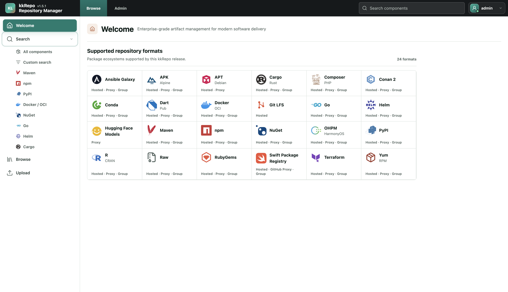
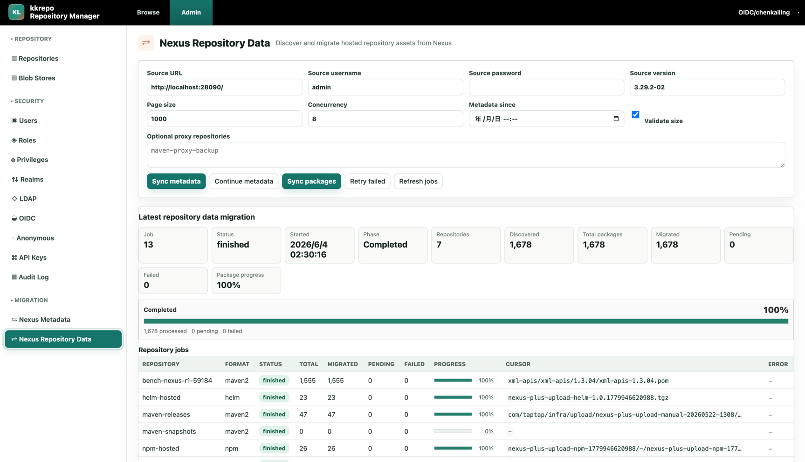
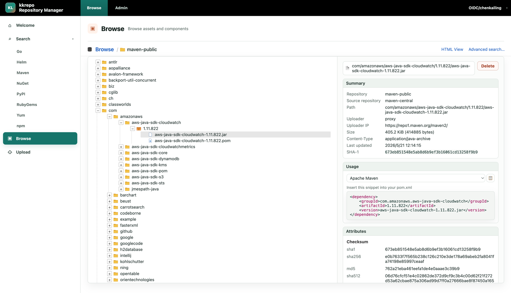
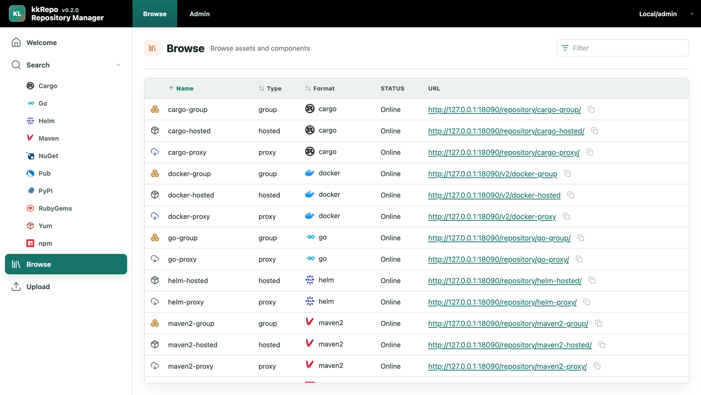
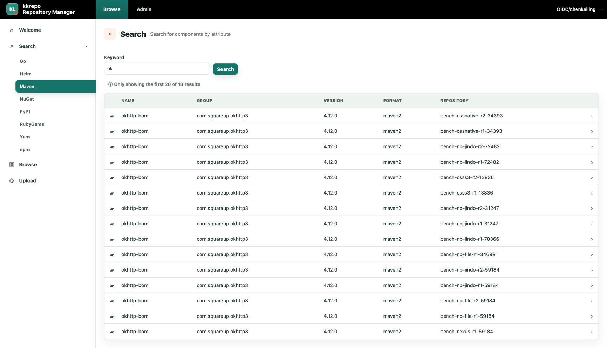
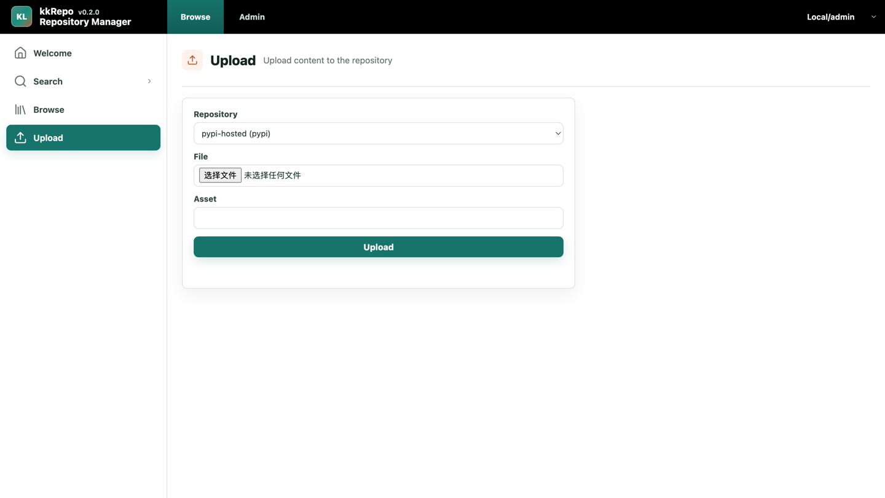
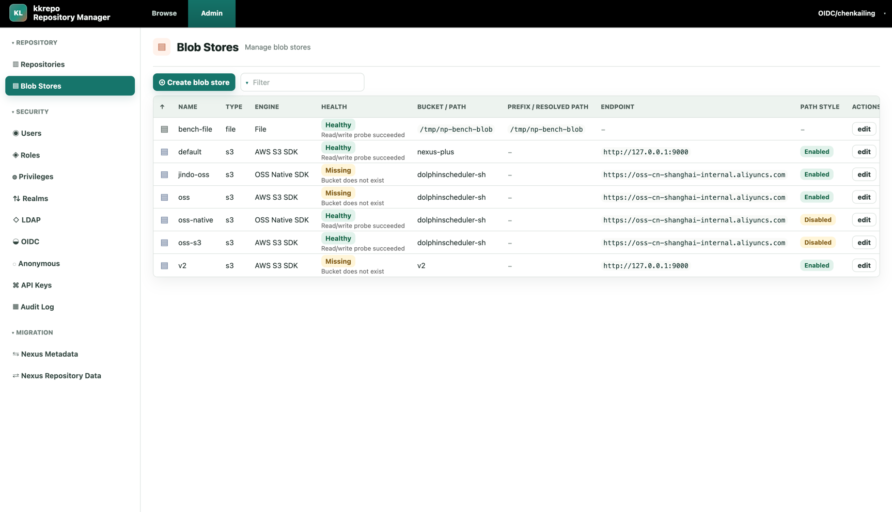
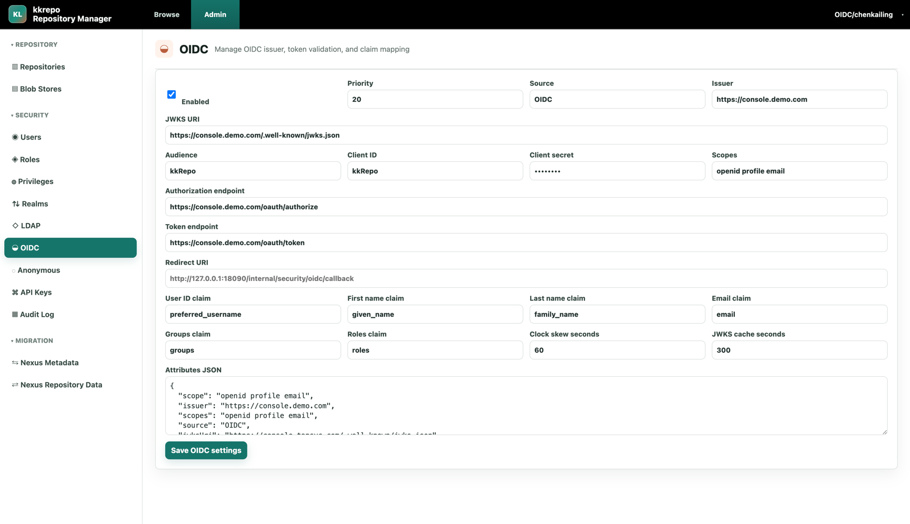
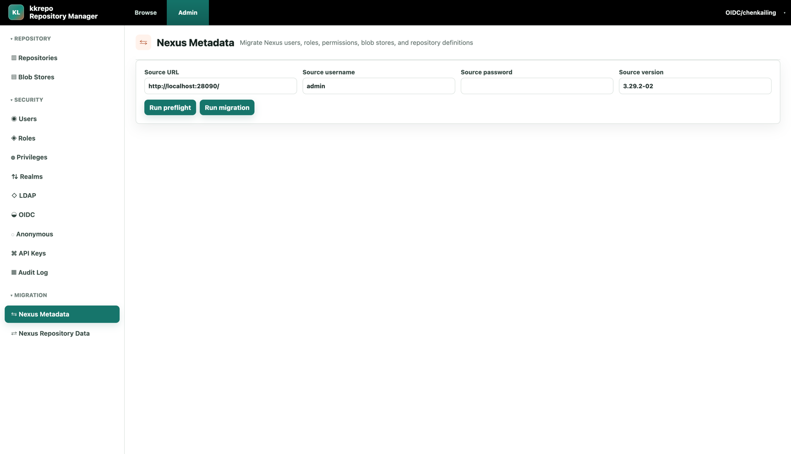

# kkRepo

[](https://github.com/klboke/kkrepo/actions/workflows/ci.yml)
[](https://codecov.io/gh/klboke/kkRepo)
[](https://github.com/klboke/kkrepo/releases)
[](LICENSE)
[](https://github.com/klboke/kkrepo/pkgs/container/kkrepo)
[](SECURITY.md)

[English](README.md) | [中文](README.cn.md) | **Türkçe**

kkRepo, topluluk odaklı, açık kaynaklı ve kendi sunucunuzda barındırabileceğiniz bir yapıt (artifact) deposudur. Sonatype Nexus Community Edition'ın sınırlamalarını ve operasyonel zorluklarını aşmak ve topluluğa zaman içinde sürdürülebilir, güvenilir ve açık bir yapıt yöneticisi sunmak amacıyla geliştirilmiştir.

Özel paketler yayınlamak, yukarı akış (upstream) bağımlılıklarını önbelleğe almak veya mevcut Sonatype Nexus Repository kurulumlarını taşımak için kullanabilirsiniz. Maven, npm ve Docker/OCI dahil 24 formatı destekler.

[Neden kkRepo?](docs/en/why-kkrepo.md) · [Hızlı başlangıç](#hızlı-başlangıç) · [Desteklenen depolar](#desteklenen-depolar) · [Temel özellikler](#temel-özellikler) · [Nexus'tan geçiş](#sonatype-nexus-repositoryden-geçiş) · [Üretim dağıtımı](docs/en/build-deployment-guide.md)



## Hızlı Başlangıç

Docker, Docker Compose ve curl kurulu iken, kkRepo'yu JVM ve MySQL üzerinde başlatmak için boş bir dizinde şu komutu çalıştırın:

```bash
curl -fsSL https://raw.githubusercontent.com/klboke/kkrepo/main/scripts/quickstart.sh | bash
```

### İlk yapıtınızı yükleyin

1. [Yönetici konsolunu](http://127.0.0.1:19090/admin/) açın ve ilk yerel yönetici `admin` için bir parola belirleyin.
2. **Blob Stores** altında, bu yerel deneme için `default` adında bir File blob deposu oluşturun.
3. **Repositories** altında `raw-hosted` seçeneğini seçin, depoya `raw-demo` adını verin, az önce oluşturduğunuz blob deposunu seçin ve kaydedin.

Bir satır metin yükleyin, ardından aynı URL'den geri okuyun. curl istediğinde admin parolasını girin.

```bash
url=http://127.0.0.1:19090/repository/raw-demo/hello.txt
printf 'Hello, kkRepo!\n' > hello.txt
curl --fail --user admin --upload-file hello.txt "$url"
curl --fail --user admin "$url"
```

İndirme `Hello, kkRepo!` yazdırdığında ilk yapıtınızı yayınlamış ve geri almış olursunuz. `hello.txt` dosyasının boyutunu, sağlama toplamlarını (checksum) ve indirme URL'sini görmek için [depo tarayıcısında](http://127.0.0.1:19090/browse/) `raw-demo` deposunu açın.

<details>
<summary>PostgreSQL, Native imajlar ve sağlık kontrolleri</summary>

Varsayılan çalışma zamanı ve veritabanı JVM ve MySQL'dir. PostgreSQL için başlangıç komutundaki `| bash` kısmını `| KKREPO_DATABASE_TYPE=postgresql bash` ile değiştirin. Native imaj için `| KKREPO_RUNTIME=native bash` kullanın. Her iki değişkeni birlikte ayarlayabilirsiniz.

[Yerel sağlık kontrolü](http://127.0.0.1:19091/actuator/health) · [Başlangıç betiğini incele](scripts/quickstart.sh) · [Derleme ve dağıtım kılavuzu](docs/en/build-deployment-guide.md)

</details>

## Desteklenen Depolar

| Format | Barındırılan (Hosted) | Vekil (Proxy) | Grup (Group) | [Nexus geçişi](docs/en/nexus-migration-guide.md) |
| :--- | :---: | :---: | :---: | :---: |
| [Maven](docs/en/repository-guides/maven.md) | ✓ | ✓ | ✓ | ✓ |
| [npm](docs/en/repository-guides/npm.md) | ✓ | ✓ | ✓ | ✓ |
| [OHPM / HarmonyOS](docs/en/repository-guides/ohpm.md) | ✓ | ✓ | ✓ | ✗ |
| [PyPI](docs/en/repository-guides/pypi.md) | ✓ | ✓ | ✓ | ✓ |
| [Go](docs/en/repository-guides/go.md) | ✓ | ✓ | ✓ | ✓ |
| [Helm](docs/en/repository-guides/helm.md) | ✓ | ✓ | ✓ | ✓ |
| [Cargo / Rust](docs/en/repository-guides/cargo-rust.md) | ✓ | ✓ | ✓ | ✓ |
| [Dart / Pub](docs/en/repository-guides/dart-pub.md) | ✓ | ✓ | ✓ | ✓ |
| [Composer / PHP](docs/en/repository-guides/composer-php.md) | ✓ | ✓ | ✓ | ✓ |
| [Terraform Provider / Module Registry](docs/en/repository-guides/terraform.md) | ✓ | ✓ | ✓ | ✓ |
| [Swift Package Registry](docs/en/repository-guides/swift-package-registry.md) | ✓ | ✓ | ✓ | ✓ |
| [Ansible Galaxy](docs/en/repository-guides/ansible-galaxy.md) | ✓ | ✓ | ✓ | ✓ |
| [Conda](docs/en/repository-guides/conda.md) | ✓ | ✓ | ✓ | ✓ |
| [APT / Debian](docs/en/repository-guides/apt-debian.md) | ✓ | ✓ | ✗ | ✓ |
| [Conan 2](docs/en/repository-guides/conan-2.md) | ✓ | ✓ | ✓ | ✓ |
| [Alpine / APK](docs/en/repository-guides/alpine-apk.md) | ✓ | ✓ | ✓ | ✓ |
| [R / CRAN](docs/en/repository-guides/r-cran.md) | ✓ | ✓ | ✓ | ✓ |
| [Hugging Face Models](docs/en/repository-guides/hugging-face-models.md) | ✗ | ✓ | ✗ | ✓ |
| [Docker / OCI](docs/en/repository-guides/docker-oci.md) | ✓ | ✓ | ✓ | ✓ |
| [NuGet](docs/en/repository-guides/nuget.md) | ✓ | ✓ | ✓ | ✓ |
| [RubyGems](docs/en/repository-guides/rubygems.md) | ✓ | ✓ | ✓ | ✓ |
| [Yum](docs/en/repository-guides/yum.md) | ✓ | ✓ | ✓ | ✓ |
| [Git LFS](docs/en/repository-guides/git-lfs.md) | ✓ | ✗ | ✗ | ✓ |
| [Raw](docs/en/repository-guides/raw.md) | ✓ | ✓ | ✓ | ✓ |

Nexus geçişi sütunundaki ✓ işareti, formatın desteklenen bir geçiş yoluna sahip olduğu anlamına gelir. Geçiş kılavuzu kapsanan depo türlerini, verileri ve Nexus sürümlerini listeler.

## Temel Özellikler

- **Yapıt dağıtımı.** Barındırılan depolar ekibinizin sürümlerini saklar, vekil depolar yukarı akış paketlerini isteğe bağlı olarak önbelleğe alır ve gruplar istemcilere birden fazla depodan okuma için tek bir URL sunar. Her formatın desteklenen türleri için yukarıdaki matrise bakın.
- **Akışlı vekil indirmeler.** İstemcilerin önbelleğe alınmamış bir Docker katmanını, Maven yapıtını veya PyPI paketini kkRepo yukarı akıştan okurken indirmeye başlayabilmesi için vekil depo başına akışı etkinleştirin. Önbelleğe yalnızca eksiksiz ve doğrulanmış yapıtlar eklenir. [Desteklenen yapıtlar ve akış koşulları](docs/en/dev/proxy-streaming-downloads.md)
- **İndirme yükünü devretme (Download offload).** Bir File blob deposundaki yapıtlar için kkRepo erişim ve tarama politikalarını kontrol edebilir, ardından tam dosya indirmesini Nginx gibi güvenilir bir ters vekil sunucuya devredebilir. Vekil sunucu baytları doğrudan sunarak uygulama kopyaları üzerindeki trafiği azaltır. [Nginx indirme devrini yapılandırın](docs/en/nginx-reverse-proxy.md#download-offload)
- **Kimlik ve erişim.** Yerel hesaplar, LDAP veya OIDC ile oturum açın. Roller aracılığıyla depo izinleri atayın, CI için belirteçler (token) oluşturun ve anonim okumaları yapılandırın. [Güvenlik modeli](docs/en/security-model.md)
- **Tarama ve temizlik.** Seçili depolar için SBOM oluşturmayı ve güvenlik açığı taramasını etkinleştirin, muafiyetlerle indirme politikalarını uygulayın ve bir temizlik politikasının hangi yapıtları sileceğini önizleyin. [Yapıt taraması](docs/en/artifact-scanning-guide.md) · [Temizlik politikaları](docs/en/cleanup-policy-guide.md)
- **Çoklu kopya (Replica) desteği.** Kopyalar meta verileri, oturumları ve görev durumunu MySQL veya PostgreSQL üzerinden paylaşır. Üretim yapıtlarını S3, Alibaba Cloud OSS veya Azure Blob Storage içinde saklayın. [Dağıtım mimarisi](docs/en/build-deployment-guide.md) · [Azure depolama](docs/en/azure-blob-storage.md)

Varsayılan dağıtım JVM üzerinde çalışır. İsteğe bağlı bir Native imaj, iki CPU ve 1 GiB ile sınırlandırılmış yerel bir kıyaslama testinde konteyner oluşturulduktan sonra medyan **1,04 saniyede** hazır hale geldi ve boşta medyan **170,4 MiB** konteyner belleği kullandı. Test kurulumu ve ısınmış aktarım hızı için [Native ve JVM karşılaştırması](docs/en/native-vs-jvm-guide.md) belgesine bakın.

## Sonatype Nexus Repository'den Geçiş

kkRepo ekibi kendi depolarını taşırken özgün alan adını korudu. Geçiş sonrasında CI aynı Maven ayarlarını, npm kayıt defterini ve PyPI dizin URL'sini kullanmaya devam etti. Dağıtım geçmişi ve sonuç için [ekibin geçiş öyküsünü](docs/en/why-kkrepo.md#migration-result) okuyun.

1. **Kapsamı kontrol edin ve ön kontrolü çalıştırın.** Kaynak Nexus sürümünü, depo formatlarını ve ihtiyacınız olan verileri kontrol edin. Yönetici konsolundaki **Nexus Metadata** sayfasında ön kontrolü (preflight) çalıştırın ve bildirdiği engelleri çözün.
2. **Yapılandırmayı ve yapıtları taşıyın.** Önce kullanıcıları, izinleri ve depo tanımlarını taşıyın. Ardından meta verileri ve paketleri eşitlemek için **Nexus Repository Data** kullanın. Tam eşitleme ile başlayın. Sonraki çalıştırmalar artımlı olabilir ve kesintiye uğrayan aktarımlar kaldığı yerden devam edebilir.
3. **Doğrulayın ve geçişi tamamlayın.** Özgün alan adını kkRepo'ya yönlendirmeden önce mevcut istemcilerinizle izinleri ve indirmeleri test edin. Çoğu istemci `/repository/<repo>/...` URL'lerini korur. Docker/OCI için `/v2/` giriş noktasını, depo adlarını ve kayıt defteri yönlendirmesini koruyun.



[Formata göre geçiş kapsamı ve önkoşullar](docs/en/nexus-migration-guide.md) · [Geçiş uygulama kılavuzu](docs/en/migration-playbook.md)

<details>
<summary>Browse ve Admin ekranlarından daha fazla görüntü</summary>















</details>

## Belgeler

| Konu | Önerilen okuma |
| --- | --- |
| Kökenler ve benimsenme | [kkRepo'yu neden geliştirdik](docs/en/why-kkrepo.md) · [Bir güneş enerjisi üreticisinin Nexus'tan geçiş öyküsü (Çince)](docs/zh/blog/nexus-to-kkrepo-migration-case.md) |
| Mimari ve tasarım seçimleri | [Mimari](docs/en/architecture.md) · [Veritabanı arka uçları](docs/en/database-backends.md) · [Veritabanı şeması](docs/en/database-schema.md) · [MySQL varlık ilişkileri](docs/en/mysql-er.md) |
| Uyumluluk ve doğrulama | [Format uyumluluk matrisi](docs/en/compatibility-matrix.md) · [kkRepo'nun Nexus'a karşı test yöntemi](docs/en/nexus-compatibility-testing.md) · [Nexus REST API uyumu](docs/en/dev/nexus-rest-api-alignment.md) |
| Performans kıyaslamaları | [Native vs. JVM](docs/en/native-vs-jvm-guide.md) · [Akışlı vekil indirmeler](docs/en/dev/proxy-streaming-performance.md) · [Nexus'a karşı APT](docs/en/dev/apt-performance-baseline.md) |
| Depolar ve istemciler | [Format kılavuzları](docs/en/repository-guides/README.md) · [İstemci örnekleri](docs/en/client-recipes.md) · [kkRepo ile özel Maven deposu kurulumu](docs/en/blog/setup-maven-private-repository-with-kkrepo.md) |
| Nexus'tan geçiş | [Kapsam ve önkoşullar](docs/en/nexus-migration-guide.md) · [Geçiş uygulama kılavuzu](docs/en/migration-playbook.md) |
| Dağıtım ve operasyon | [Derleme ve dağıtım](docs/en/build-deployment-guide.md) · [Üretim sıkılaştırma](docs/en/production-hardening.md) · [Nginx ters vekil sunucu](docs/en/nginx-reverse-proxy.md) · [İzleme](docs/en/monitoring-observability-guide.md) · [Yedekleme ve geri yükleme](docs/en/backup-restore.md) |
| Erişim ve yapıt yönetimi | [Güvenlik modeli](docs/en/security-model.md) · [İçerik seçiciler](docs/en/content-selectors.md) · [Yapıt taraması](docs/en/artifact-scanning-guide.md) · [Temizlik politikaları](docs/en/cleanup-policy-guide.md) · [Depolama kullanımı](docs/en/admin-storage-usage.md) |
| Sorun giderme ve geliştirme | [SSS](docs/en/faq.md) · [Sorun giderme](docs/en/troubleshooting.md) · [Geliştirme kılavuzu](docs/en/development-guide.md) |

## Yol Haritası

### Planlanan

- **Eclipse p2** — Eclipse ve Equinox güncelleme sitelerini vekil olarak sunma.
- **CocoaPods** — Nexus uyumlu bir vekil depo üzerinden bağımlılıkları çekme.

### Teslim Edilen

| Platform yeteneği | Teslim edilen yetenek | Belgeler |
| --- | --- | --- |
| PostgreSQL arka ucu | Geçiş ve çoklu kopya testleriyle MySQL ve PostgreSQL arka uçları. | [veritabanı arka uç kılavuzu](docs/en/database-backends.md) · [Çince tasarım planı](docs/zh/dev/pluggable-database-access-layer-design.md) |
| Yapıt taraması | Her depo için SBOM oluşturma ve güvenlik açığı analizi eşzamansız yürütülür. İstenirse tarama politikasına uymayan indirmeler engellenebilir. | [kullanım kılavuzu](docs/en/artifact-scanning-guide.md) · [Çince tasarım notları](docs/zh/dev/security-scanning-design.md) |

<details>
<summary>Depo formatı kilometre taşları (17)</summary>

| Format | Teslim edilen yetenek | Belgeler |
| --- | --- | --- |
| Docker / OCI | İmaj gönderme (push), çekme (pull) ve yukarı akış önbellekleme. | [uygulama notları](docs/en/dev/docker-repository-implementation-plan.md) |
| Cargo / Rust | Crate yayınlama, arama ve Nexus depo geçişi. | [tasarım notları](docs/en/dev/cargo-rust-repository-design.md) |
| Dart / Pub | Gerçek istemcilerle doğrulanmış paket yayınlama, arama ve Nexus geçişi. | [Çince tasarım notları](docs/zh/dev/dart-pub-repository-design.md) |
| Composer / PHP | Composer 2 kurulumları ve açıkça seçilen Nexus vekil önbelleklerinin geçişi. | [Çince tasarım notları](docs/zh/dev/composer-php-repository-design.md) |
| Terraform | Sağlayıcılar için GPG imzalama destekli modül ve sağlayıcı kayıt defterleri. | [Çince tasarım notları](docs/zh/dev/terraform-repository-design.md) |
| Swift Package Registry | SwiftPM ve Xcode ile doğrulanmış imzalı, değişmez sürümler. | [Çince tasarım notları](docs/zh/dev/swift-package-registry-design.md) |
| Ansible Galaxy | Galaxy v3 koleksiyon yayınlama, bağımlılık çözümleme ve çoklu kopya içe aktarımları. | [kullanım kılavuzu](docs/en/repository-guides/ansible-galaxy.md) · [Çince tasarım notları](docs/zh/dev/ansible-galaxy-repository-design.md) |
| Conda | JSON, BZ2 ve ZSTD repodata ile her iki Conda paket formatı. | [Çince tasarım notları](docs/zh/dev/conda-repository-design.md) |
| APT / Debian | APT istemcileri ve bir Nexus referans örneği ile doğrulanmış imzalı depo meta verileri. | [kullanım kılavuzu](docs/en/repository-guides/apt-debian.md) · [Çince tasarım notları](docs/zh/dev/apt-debian-repository-design.md) · [performans temeli](docs/en/dev/apt-performance-baseline.md) |
| Conan 2 | Revizyon yayınlama, temizlik ve bileşik paket taraması. | [kullanım kılavuzu](docs/en/repository-guides/conan-2.md) · [Çince tasarım notları](docs/zh/dev/conan-repository-design.md) · [performans temeli](docs/en/dev/conan-performance-baseline.md) |
| Alpine / APK | APK v2 doğrulama, imzalı dizinler ve vekil yeniden imzalama. | [kullanım kılavuzu](docs/en/repository-guides/alpine-apk.md) · [Çince tasarım notları](docs/zh/dev/alpine-apk-repository-design.md) · [performans temeli](docs/en/dev/alpine-performance-baseline.md) |
| Hugging Face Models | LFS ve Xet desteğiyle bir commit'e sabitlenmiş model indirmeleri. | [kullanım kılavuzu](docs/en/repository-guides/hugging-face-models.md) · [Çince tasarım notları](docs/zh/dev/hugging-face-models-repository-design.md) · [performans temeli](docs/en/dev/hugging-face-models-performance-baseline.md) |
| R / CRAN | R istemcileriyle kurulum için dizin başına PACKAGES.gz dizinleri. | [kullanım kılavuzu](docs/en/repository-guides/r-cran.md) · [Çince tasarım notları](docs/zh/dev/r-cran-repository-design.md) · [performans temeli](docs/en/dev/r-cran-performance-baseline.md) |
| Go | Go istemcisiyle doğrulanmış geçerli modül ZIP yayını. | [kullanım kılavuzu](docs/en/repository-guides/go.md) · [performans temeli](docs/en/dev/go-hosted-performance-baseline.md) |
| OHPM / HarmonyOS | Akışlı HAR/HSP yayınlama, kaldığı yerden devam eden içe aktarımlar ve isteğe bağlı imzalı oturum açma. | [kullanım kılavuzu](docs/en/repository-guides/ohpm.md) · [imzalı oturum açma](docs/en/dev/ohpm-login.md) · [test kapsamı ve sınırları](docs/en/dev/ohpm-acceptance.md) |
| Helm groups | Yapılandırılan üye sırasına göre iç içe gruplar genelinde birleştirilen chart dizinleri. | [kullanım kılavuzu](docs/en/repository-guides/helm.md) |
| Git LFS | Depo izinleriyle toplu işlemler, akışlı yüklemeler ve nesne doğrulama. | [kullanım kılavuzu](docs/en/repository-guides/git-lfs.md) · [uygulama tasarımı](docs/zh/dev/git-lfs-repository-design.md) |

</details>

[Tam değişiklik günlüğü](CHANGELOG.md)

## kkRepo'yu Kimler Kullanıyor?

Ekibiniz kkRepo kullanıyorsa, kuruluşunuzun adını ve onu nasıl kullandığınızla ilgili kısa bir bilgiyi [kullanıcı kayıt issue'sunda](https://github.com/klboke/kkRepo/issues/94) paylaşın. Örneğin, Nexus'tan mı geçiş yaptınız yoksa ilk özel yapıt deponuzu mu kurdunuz? Hikayeniz, kkRepo'yu değerlendiren ekiplerin kendilerine benzer bir kullanım senaryosu bulmasına yardımcı olur ve bakımcılara projeye kimlerin güvendiği ve neye ihtiyaç duydukları konusunda daha net bir fikir verir.

Kayıt issue'su benimseme hikayeleri içindir. Hatalar ve özellik istekleri için lütfen [issue şablonlarını](https://github.com/klboke/kkRepo/issues/new/choose) kullanın.

## Katkıda Bulunma

Issue ve pull request'ler her zaman memnuniyetle karşılanır. Katkıda bulunan iş akışı, PR beklentileri, uyumluluk testi beklentileri ve çoklu kopya tasarım kısıtlamaları için [CONTRIBUTING.md](CONTRIBUTING.md) dosyasına bakın. Topluluk davranış beklentileri [CODE_OF_CONDUCT.md](CODE_OF_CONDUCT.md) dosyasında belgelenmiştir.

Yerel geliştirme ve test işlemleri [Geliştirme Kılavuzu](docs/en/development-guide.md) içinde belgelenmiştir. Derleme ve dağıtım [Derleme ve Dağıtım Kılavuzu](docs/en/build-deployment-guide.md) içinde belgelenmiştir. Yapay zeka ajanı ve katkıda bulunan kısıtlamaları [AGENTS.md](AGENTS.md) dosyasındadır.

## Destek

Topluluk desteği ve kullanım tartışmaları için [kkRepo Telegram grubuna](https://t.me/+UbIsTKXTzxBhYjFl) katılın. Issue yönlendirme, destek kapsamı ve güvenlik bildirim sınırları için [SUPPORT.md](SUPPORT.md) dosyasına bakın.

## Sponsorlar

kkRepo'nun devam eden geliştirme ve bakımını destekleyen herkese teşekkürler. Projeyi [GitHub Sponsors](https://github.com/sponsors/klboke) üzerinden destekleyebilirsiniz.

kkRepo'ya Alipay veya WeChat Pay üzerinden de sponsor olabilirsiniz.

<p>
  <a href="docs/img/sponsors/alipay.jpg"></a>
  &nbsp;&nbsp;
  <a href="docs/img/sponsors/wechat-pay.jpg"></a>
</p>

### Kurumsal Sponsorlar

Aktif kurumsal sponsorlar burada logoları ve bağlantılarıyla öne çıkarılacaktır.

### Proje Destekçileri

Aktif proje destekçileri burada adları veya logoları ve isteğe bağlı bağlantılarıyla anılacaktır.

## Güvenlik

Bir güvenlik sorunu bulursanız [SECURITY.md](SECURITY.md) dosyasını izleyin ve önce GitHub Security Advisory üzerinden bildirin. İstismar edilebilir ayrıntıları herkese açık issue'larda açıklamaktan kaçının. Normal hatalar, uyumluluk sorunları ve özellik istekleri herkese açık issue olarak gönderilebilir.

## Lisans

kkRepo, [Apache License 2.0](LICENSE) altında açık kaynaklıdır.

## Ticari Marka Bildirimi

Sonatype, Nexus ve Nexus Repository; Sonatype, Inc. şirketinin ticari markalarıdır. kkRepo bağımsız bir açık kaynak projesidir ve Sonatype, Inc. ile bağlantılı değildir; onun tarafından onaylanmamış, desteklenmemiş veya sponsorluk almamıştır. Sonatype Nexus Repository referansları yalnızca uyumluluk, geçiş veya birlikte çalışabilirliği açıklamak amacıyla kullanılmıştır.
